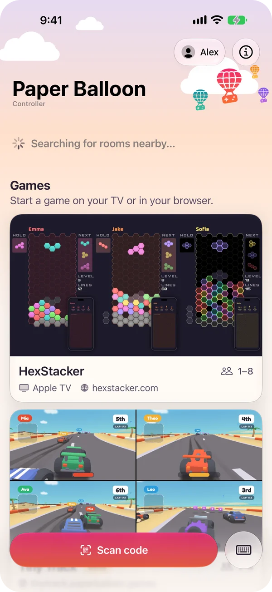
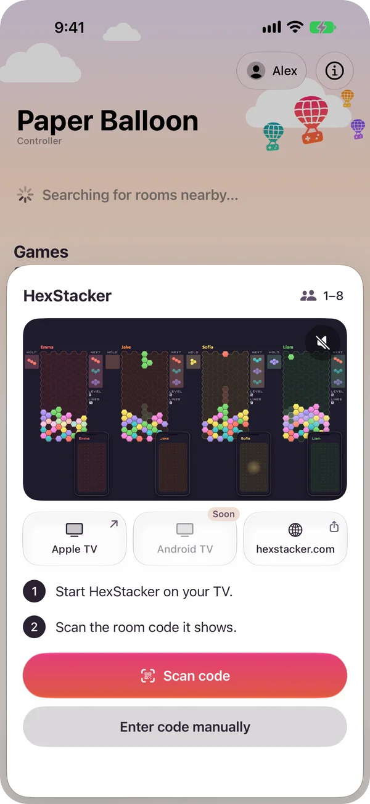
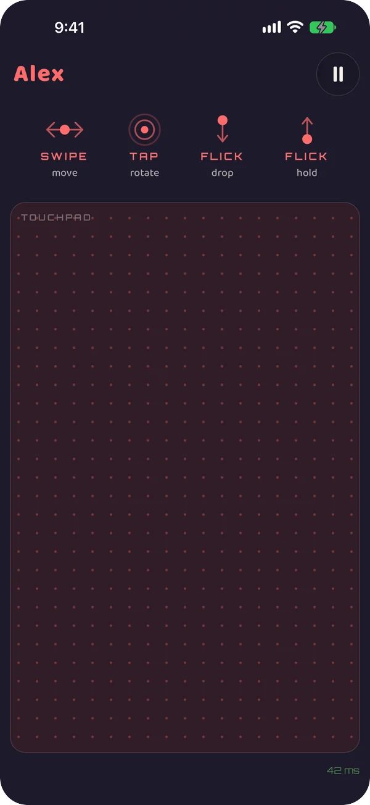

# Paper Balloon Controller

[Paper Balloon](https://paperballoon.games) is a set of party games played on
one shared screen. This is the phone app that goes with them: start a game on
the TV or in a browser, scan the room code it shows, and your phone is the
controller.

**[Download on the App Store](https://apps.apple.com/us/app/paper-balloon-controller/id6825072879)**
· Android is in closed testing, [join the beta](https://paperballoon.games/beta)

<p align="center">
  
  
  
</p>

## How it works

The two apps are native ports of each other and behave the same: Kotlin with
Jetpack Compose on Android, Swift with SwiftUI on iOS.

The home screen is native. A game's controller is not: it is a web page served
by the game, opened full screen in a locked-down web view. Games can change
their controller without an app release, and the same page keeps working in a
plain mobile browser for players who never install anything. The app exists for
what a browser can't do: vibrate or lock the orientation on iOS, and find a
room on the local network.

- The page and the app talk through a small JavaScript bridge,
  `window.PaperBalloonHost`, specified in [CONTRACT.md](CONTRACT.md): the
  player's name and a native rename sheet, leaving the game, the back button,
  orientation, haptics and the status bar colors. Pages feature-detect every
  part of it, which is what keeps them working in a browser.
- The web view only loads https pages on the game's own domains. A link the
  player taps to anywhere else opens in the browser, and everything else is
  blocked. A join link from a QR code or the relay server is checked against
  the manifest's hosts before anything loads.
- Rooms nearby appear on the home screen without scanning. A native TV app
  can advertise its room code over mDNS, and a phone already in a room
  advertises it too, so rooms hosted in a browser show up as well.
- The games list is a JSON manifest the website serves, so a new game reaches
  installed apps without an update.
- Scanning stays on the device: CameraX with zxing-cpp on Android,
  AVFoundation on iOS. Neither app contains analytics or ad SDKs.
- On iOS the same code also builds as an App Clip, which opens a scanned room
  link without installing the app.

Logic the two apps must agree on exactly (parsing join links, haptic patterns)
is tested from shared JSON cases in `tests/` that both unit test suites run.
UI tests on both platforms drive a live contract test page through the real
bridge, and the screenshots above come out of the store screenshot UI tests in
CI.

## Repository layout

- `android/`: the Android app (Kotlin, Jetpack Compose).
- `ios/`: the iOS app and its App Clip (Swift, SwiftUI); see
  [ios/README.md](ios/README.md). Both apps split their sources the same way:
  data, the home screen, the game's web view and the theme.
- `tests/`: test cases both apps run.
- `tools/`: the localization check, the artwork encoder and the app icon
  generator.
- `third_party/zxing-cpp/`: upstream zxing-cpp as a git submodule. Android
  compiles its QR decoder from it instead of using the published AAR; the
  reason is in `android/app/build.gradle.kts`.

## Building

Android: open `android/` in Android Studio, or

```sh
git submodule update --init third_party/zxing-cpp             # once per checkout
cd android
echo "sdk.dir=$HOME/Library/Android/sdk" > local.properties   # once per checkout
./gradlew assembleDebug
adb install -r app/build/outputs/apk/debug/app-debug.apk
```

iOS: the Xcode project is generated, not committed. The simulator has no
camera, so there you join by typing the room code.

```sh
cd ios
xcodegen generate    # brew install xcodegen, once
open PaperBalloon.xcodeproj
```

## Localization

Both apps ship in the same 11 languages: Android in
`res/values[-XX]/strings.xml`, iOS in `PaperBalloon/Resources/*.xcstrings`.
Per-game text such as player counts lives in those same resources under
`game_<id>_*` keys; `games-manifest.json` holds no translated text. After any
string change, run

```sh
python3 tools/check_l10n_sync.py
```

It checks that both platforms cover every locale, that text both apps share is
translated identically (matched by the English source), and that the two
manifest copies are byte-identical. A string that exists on one platform only
must be listed in the script's `ANDROID_ONLY` or `IOS_ONLY`, or the check
fails.

## Where things live

The games list is `android/app/src/main/assets/games-manifest.json`. It drives
the home screen, resolving scanned and typed codes, and the relay lookups.
Cover art (`art`, 16:9) and the square icon the nearby-room card uses (`icon`)
sit next to it in `assets/artwork/`. The iOS app bundles copies in
`ios/PaperBalloon/Resources/`; change both together.

The bundled manifest only seeds the first launch. On every launch both apps
fetch `paperballoon.games/games-manifest.json` (served no-cache from the
website repo), store it and render from it, so a new game or a status change
is one website deploy.

Art the running build doesn't ship is downloaded into a cache keyed by URL and
never revalidated; entries the manifest no longer names are deleted after each
fetch. Bundled art is matched by file name. So a changed image needs a **new
file name** (for example `hexstacker-16x9-v2.webp`), in the served manifest and
in both bundles. New bytes under an old name go unnoticed, by design. A `?v=`
query doesn't work for art: it ends up in the file name both bundle lookups
use, so every install would download art it already has. Trailers (`video`)
are never bundled, so a changed trailer only needs a `?v=` bump once the new
file is live.

Encode covers with

```sh
tools/encode_artwork.sh <master>...    # 1280x720, quality 85, writes both bundles
```

1280x720 is the largest size either app decodes, so anything bigger is
download weight no screen shows. The script isn't part of the build. Give it
masters, since every run is another lossy re-encode.

The launcher icon (Android `ic_launcher_*` layers and legacy mipmaps, iOS
`AppIcon.icon` plus the `AppIcon.appiconset` fallback) is generated from one
drawing: edit and run `uv run tools/app_icon.py`, then commit what it writes.
